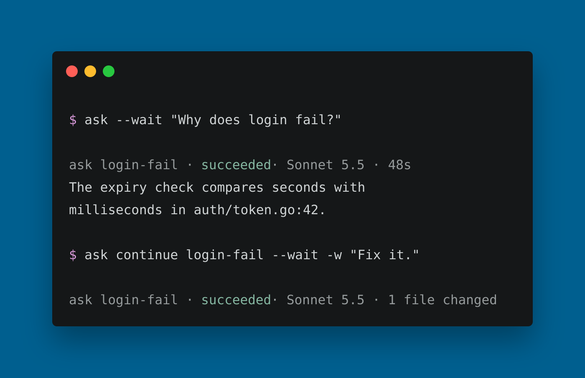

# ask

**Every model, as a subagent.** Hand tasks to your coding agents, on any model they run, from your
terminal or from another agent. One task or many at once, recorded, with live usage.



ask works with the coding agent CLIs you already use. Each task runs in a real agent conversation,
gets a stable ID and a name, and is saved in `~/.ask/runs`, so you can inspect it, wait for it, or
continue it later.

## Install

macOS and Linux:

```sh
curl -fsSL https://raw.githubusercontent.com/arocomputer/ask/main/install.sh | sh
```

Homebrew:

```sh
brew tap arocomputer/ask https://github.com/arocomputer/ask
brew install ask
```

With Go 1.26 or newer:

```sh
go install github.com/arocomputer/ask@latest
```

One binary; no additional UI runtime to install. `ask update` keeps a curl install current.
More in [Install](docs/install.md).

## Start

Install and authenticate at least one coding agent CLI: Claude Code, Codex, OpenCode, or another
[supported harness](packages/README.md). The official ask agents need Node.js 18 or newer.
`ask setup` installs the agents; it does not install or sign in to the CLIs.

Then, in a project directory:

```sh
ask setup                                        # connect the coding agents you have
ask models                                       # choose an available agent:model id
id=$(ask -m claude:sonnet-5.5 "Why does the login test fail?")
ask wait "$id"                                   # block and print the answer
ask continue "$id" --wait -w "Fix it, then run the test."
```

`ask setup` finds supported CLIs, installs the agents you pick, and shows changes to defaults and
app integrations before saving them. Each agent keeps its own login. The examples use Claude Code;
choose a model from `ask models` for your installation. Model ids look like `claude:opus-5.5`,
`codex:gpt-6.1-sol`, or `opencode:deepseek-4.1-flash`. `-m` / `--model` selects a model or
configured role, and `-w` / `--write` allows edits and commands. Runs are read-only by default.

A launch detaches and prints only the run's stable ID. Exit 0 means accepted, not finished. Add
`--wait` to run synchronously and return the answer. With a default model configured, you can also
pipe a prompt directly:

```sh
git diff | ask          # detach and print the run ID
git diff | ask --wait   # return the answer
```

Status and errors go to stderr. With a default model configured in `ask settings`, `ask "prompt"`
and `ask run "prompt"` use it. See [Usage](docs/usage.md).

## Many at once

`ask batch FILE` launches parallel tasks and returns one stable batch ID. `ask batch --wait FILE`
returns the result array synchronously. `ask show ID` inspects current state; `ask wait ID` blocks
for completion.

For scripts, `ask runs --json` lists machine-readable state and `ask wait ID --json` returns result
data, including failures. Check the exit status: wait returns 1 for failed or stopped work.

## Follow-ups and worktrees

Every run is named and recorded, with time, changes and usage when reported.
`ask continue RUN "prompt"` continues the same agent conversation, keeping the model and access
unless you change them. Without a prompt, it finishes stopped or failed work in a usable saved
conversation, or explains what needs an explicit prompt. `ask stop ID` cancels work; interrupting
`ask wait` only stops waiting.

Use `--worktree` with `--write` to give a run its own Git worktree and branch, so several write
runs can work in parallel. ask keeps the worktree when it changed something, ready to review and
merge. See [Runs](docs/runs.md) and [Usage](docs/usage.md#working-in-a-worktree).

## Settings

`ask settings` holds every control: agents and their models, defaults, cost limits, worktrees, and
the apps that use ask. Nothing is written until you have seen the change.

```sh
ask settings
ask settings set max_cost 2
ask settings set worktree on
```

A cost limit stops a run when reported cost passes it; a model call or step can take it over.
See [Settings](docs/settings.md) for every key and the review before saving.

## Make it yours

ask stays small by delegating to pieces you can replace.

- **Agents** — reach any coding agent CLI through a small executable. The official ones are built
  in: `ask install claude`.
- **Hooks** — change tasks and check results: add context, guard writes, run the tests, and hand
  failures back.
- **Commands** — build your own `ask NAME` workflows, like a review by three models.
- **Packages** — share agents, hooks and commands: `ask install owner/repo`. Your own files always
  win.

Agents in Claude Code, Codex, OpenCode, Cursor and Pi can hand work to ask too. `ask setup` gives
them the ask skill, and Claude Code names each ask run in its task list. See [Hosts](docs/hosts.md).

## Documentation

`ask help` is the quick reference; `ask help COMMAND` shows one command's options. `ask docs` lists
every page and `ask docs PAGE` shows one offline, matching your version. Browse the
[docs index](docs/README.md) on GitHub.

- **Get started:** [Install](docs/install.md) · [Setup](docs/setup.md) · [Settings](docs/settings.md)
- **Run tasks:** [Usage](docs/usage.md) · [Runs](docs/runs.md) · [Batches](docs/batches.md) ·
  [Bench](docs/bench.md) · [Models](docs/models.md)
- **Extend ask:** [Agents](docs/agents.md) · [Hooks](docs/hooks.md) · [Commands](docs/commands.md) ·
  [Packages](docs/packages.md)
- **Reference:** [Hosts](docs/hosts.md) · [Environment](docs/environment.md) ·
  [Compatibility](docs/compatibility.md)

## Contributing

ask is built to stay small: the core knows nothing about any particular agent, and the official
agents use only the public contract.

```sh
./x check
```

See [CONTRIBUTING.md](CONTRIBUTING.md) for the development setup and
[docs/contributing/architecture.md](docs/contributing/architecture.md) for how a task runs. The
offline integration suite checks packaged harnesses, writing behavior and package lifecycle through
the real ask binary: `./x integration`, or `./x integration copilot` for one harness. See
[Integration](docs/contributing/integration.md).

## License

MIT. See [LICENSE](LICENSE).
