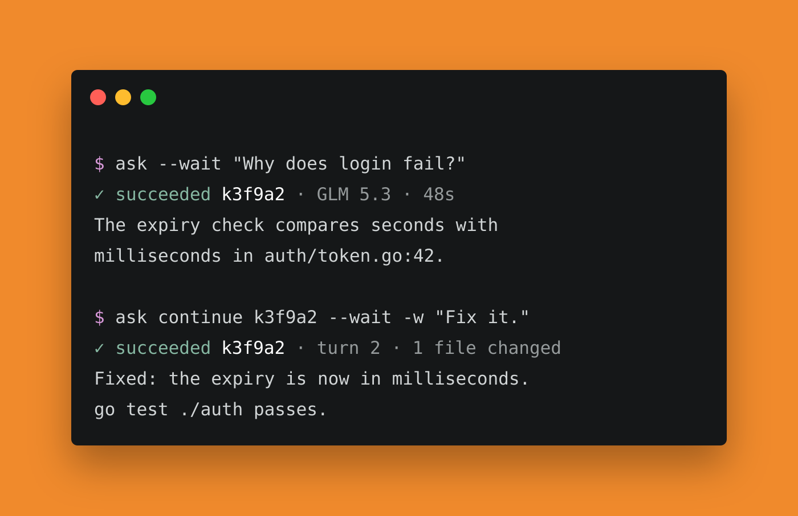

<p align="center">
  
</p>

<p align="center">
  <b>Subagents for your agents.</b> One command hands a task to a subagent that reads, searches and
  edits your project. It works in the background, recorded, with live activity and exact usage.
</p>

<p align="center">
  <a href="https://github.com/arocomputer/ask/releases/latest"></a>
  <a href="https://github.com/arocomputer/ask/actions/workflows/ci.yml"></a>
  <a href="LICENSE"></a>
</p>

```sh
curl -fsSL https://raw.githubusercontent.com/arocomputer/ask/main/install.sh | sh
```

## Start

```sh
ask setup                                   # a provider key, a default model, the ask skill
id=$(ask "Why does the login test fail?")   # a read-only session; prints its ID
ask wait "$id"                              # the answer
ask continue "$id" -w "Fix it, then run the test."
```

A session works in the background. The launch prints only its ID, `ask wait ID` prints the
answer, `ask show ID` shows what it is doing right now, and `ask continue ID` adds a turn that
remembers everything the session read, said and did. `-w` allows edits and commands, `-m`
picks a model, `--wait` prints the answer instead of the ID, `--json` prints records.

ask talks to the model itself, through OpenAI, OpenCode Console, OpenCode Go or any endpoint
that speaks the same protocol. It owns the loop, the tools and the transcript, so read-only is
enforced by the tools on offer, every tool call is recorded, and usage is exact. Claude Code and
Codex can run sessions too, as built-in extensions (`ask install claude`, then
`-m claude:sonnet-5.5`), with their own login.

<table>
  <tr>
    <td width="33%" valign="top">
      <b>Made for agents</b><br>
      Stable IDs, one JSON record per command, bounded pages of activity, and sessions scoped to
      the conversation that started them.
    </td>
    <td width="33%" valign="top">
      <b>Safe by construction</b><br>
      A read session has no tool that can write or run a command. Write sessions can work in
      their own git worktree and branch, and every change is listed.
    </td>
    <td width="33%" valign="top">
      <b>Yours to extend</b><br>
      An extension is a folder of executables: a harness for another coding agent, tools for
      the model, or your own <code>ask</code> commands. One Go binary, no dependencies, no daemon.
    </td>
  </tr>
</table>

## Many at once

```sh
a=$(ask "Review src/auth for races.")
b=$(ask -m opencode-go/glm-5.3 "Summarize the public API.")
ask wait "$a" "$b"          # the first to finish; stderr says which
ask sessions                # yours, most recently active first
ask stop "$b"
```

## Install

```sh
curl -fsSL https://raw.githubusercontent.com/arocomputer/ask/main/install.sh | sh            # macOS and Linux
brew tap arocomputer/ask https://github.com/arocomputer/ask && brew install ask
go install github.com/arocomputer/ask@latest             # Go 1.26 or newer
```

The Claude Code and Codex extensions need Node.js 18 or newer; ask itself needs nothing.

## Docs

`ask help` and `ask help COMMAND` are the reference. The pages in [docs/](docs/README.md) cover
[install](docs/install.md), [setup](docs/setup.md), [usage](docs/usage.md),
[sessions](docs/sessions.md), [models](docs/models.md), [config](docs/config.md),
[extensions](docs/extensions.md) and [compatibility](docs/compatibility.md).

<br>

<p align="center"><sub>MIT · <a href="https://github.com/arocomputer/ask">github.com/arocomputer/ask</a></sub></p>
